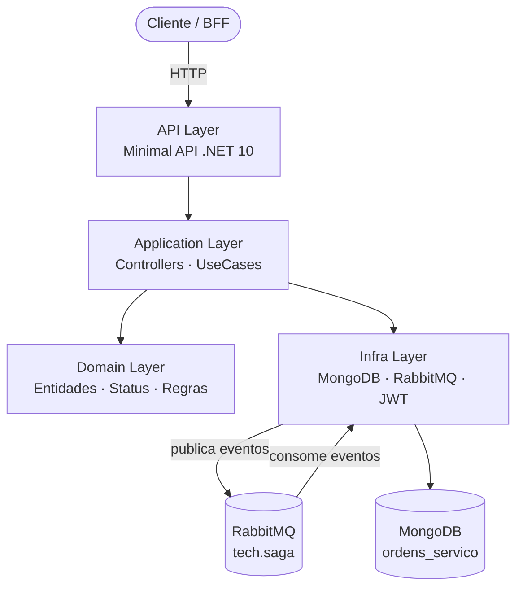

# TechChallenge.OS — Microsserviço de Ordens de Serviço

> Fase 4 — FIAP SOAT · Arquitetura de Microsserviços com Saga Pattern

Microsserviço responsável pelo **ciclo de vida completo das Ordens de Serviço (OS)**, ponto de entrada da Saga coreografada do sistema TechChallenger (oficina mecânica com escala nacional).

---

## 🔗 Repositórios do TechChallenger

| Serviço | Repositório | Responsabilidade |
|---------|-------------|------------------|
| **OS Service** ← *este* | [TechChallenge.OS](https://github.com/TechChallenge01/TechChallenge.OS) | Ciclo de vida das Ordens de Serviço |
| Billing Service | [TechChallenge.Billing](https://github.com/TechChallenge01/TechChallenge.Billing) | Orçamentos e pagamentos (Mercado Pago) |
| Cadastro Service | [TechChallenge.Cadastro](https://github.com/TechChallenge01/TechChallenge.Cadastro) | Clientes, produtos e categorias |
| Estoque Service | [TechChallenge.Estoque](https://github.com/TechChallenge01/TechChallenge.Estoque) | Reserva e liberação de peças |
| Execução Service | [TechChallenge.Execucao](https://github.com/TechChallenge01/TechChallenge.Execucao) | Fila de execução e reparos |
| BFF | [TechChallenge.bff](https://github.com/TechChallenge01/TechChallenge.bff) | Gateway + Frontend React |

---

## 🏗️ Arquitetura deste repositório



**Camadas (Clean Architecture):**

| Camada | Conteúdo |
|--------|----------|
| `Domain` | `OrdemServico`, `StatusOS`, regras de negócio, sem dependências externas |
| `Shared` | DTOs, interfaces compartilhadas |
| `Application` | Controllers, UseCases, interfaces de serviços |
| `Infra` | MongoDB, RabbitMQ consumer/publisher, JWT |
| `API` | Endpoints Minimal API, Program.cs, middleware |

**Deploy:** AWS ECS Fargate · cluster `techchallenge` · região `us-east-1`

---

## 🎯 Objetivo da Fase 4

- Refatorar a aplicação monolítica em microsserviços independentes
- Implementar o **Saga Pattern Coreografado** via RabbitMQ para consistência distribuída
- Garantir rollback automático em caso de falha em qualquer etapa do fluxo
- Pipeline CI/CD independente com testes automatizados e deploy no ECS Fargate
- Monitoramento e observabilidade com **CloudWatch** e **Datadog**

---

## 🔄 Saga Pattern — Coreografado via RabbitMQ

**Por que Coreografia?**

Escolhemos coreografia em vez de orquestração pelos seguintes motivos:
- **Desacoplamento total** — cada serviço conhece apenas os eventos que deve publicar/consumir
- **Sem ponto único de falha** — não há orquestrador central que, se cair, trava todo o fluxo
- **Resiliência independente** — cada serviço escala, faz deploy e opera sem coordenação explícita
- **Simplicidade** — o fluxo é direto o suficiente para não exigir o overhead de um orquestrador

**Exchange:** `tech.saga` (Topic, durable) · Broker: RabbitMQ 3.13 no EC2 `100.24.30.116`

### Fluxo principal (Saga Feliz)

```
OS aberta → [os.aberta] → Estoque reserva peças
                       → Billing recebe diagnóstico quando pronto [diagnostico.concluido]
Billing aprova orçamento → [orcamento.aprovado] → OS → EmExecucao
                                                 → Execucao inicia tarefa
Billing confirma pagamento → [pagamento.confirmado] → OS → EmExecucao
                                                     → Execucao prepara reparo
Execucao finaliza → [execucao.finalizada] → OS → Finalizada
```

### Fluxo de compensação (Saga Falha)

```
Billing rejeita orçamento → [orcamento.rejeitado] → OS → Cancelar() → [os.cancelada]
                                                   → Estoque libera peças reservadas
Pagamento falha → [pagamento.falhou] → OS → Cancelar() → [os.cancelada]
```

### Eventos publicados por este serviço

| Routing Key | Quando | Payload |
|-------------|--------|---------|
| `os.aberta` | Nova OS criada | `{ OrdemServicoId, ClienteId, VeiculoId }` |
| `diagnostico.concluido` | Diagnóstico registrado com valor estimado | `{ OrdemServicoId, ValorEstimado }` |
| `os.cancelada` | OS cancelada (orçamento rejeitado ou pagamento falhou) | `{ OrdemServicoId, Motivo }` |

### Eventos consumidos por este serviço

| Routing Key | Fila | Ação |
|-------------|------|------|
| `orcamento.aprovado` | `os.orcamento.aprovado` | Transição → `EmExecucao` |
| `orcamento.rejeitado` | `os.orcamento.rejeitado` | Chama `Cancelar()` |
| `pagamento.confirmado` | `os.pagamento.confirmado` | Transição → `EmExecucao` |
| `pagamento.falhou` | `os.pagamento.falhou` | Chama `Cancelar()` |
| `execucao.finalizada` | `os.execucao.finalizada` | Chama `Finalizar()` |

### Compensação (Dead Letter Queue)

- `orcamento.rejeitado` → `Cancelar()` → publica `os.cancelada`
- `pagamento.falhou` → `Cancelar()` → publica `os.cancelada`
- Mensagens não processadas → DLQ `os.saga.dlq`

---

## ⚙️ Pré-requisitos

**Execução local:**
- [.NET 10 SDK](https://dotnet.microsoft.com/download/dotnet/10.0)
- [Docker Desktop](https://www.docker.com/products/docker-desktop/)
- MongoDB 7.0 (via Docker ou Atlas)
- RabbitMQ 3.13 (via Docker)

**Infraestrutura AWS:**
- AWS CLI configurado (`aws configure`)
- Terraform ≥ 1.9
- Acesso ao cluster ECS `techchallenge` em `us-east-1`

---

## 🚀 Como Executar

### Local com Docker Compose

```bash
git clone https://github.com/TechChallenge01/TechChallenge.OS.git
cd TechChallenge.OS
docker compose up -d
```

Acesse: `http://localhost:5000/scalar` (Scalar API Docs)

### Local sem Docker

```bash
# Configure as variáveis de ambiente (ver seção abaixo)
dotnet restore src/
dotnet run --project src/API
```

### Testes

```bash
dotnet test tests/UnitTests
```

---

## 🔐 Variáveis de Ambiente

| Variável | Descrição | Exemplo |
|----------|-----------|---------|
| `ConnectionStrings__MongoDB` | URI do MongoDB | `mongodb://localhost:27017` |
| `MongoDB__DatabaseName` | Nome do banco | `techchallenge_os` |
| `RabbitMQ__Host` | Host do RabbitMQ | `localhost` |
| `RabbitMQ__Username` | Usuário RabbitMQ | `guest` |
| `RabbitMQ__Password` | Senha RabbitMQ | `guest` |
| `Jwt__Key` | Chave JWT (mín. 32 chars) | — |
| `Jwt__Issuer` | Issuer JWT | `TechChallenger` |
| `Jwt__Audience` | Audience JWT | `TechChallenger` |

Em produção, as variáveis são injetadas pelo Terraform via ECS task definition.

---

## 📡 Endpoints da API

Todos os endpoints (exceto `/health`) requerem `Authorization: Bearer <token>`.  
O token é obtido via **Cadastro Service** (`POST /auth/cpf`).

| Método | Rota | Descrição |
|--------|------|-----------|
| `GET` | `/health` | Health check |
| `POST` | `/ordens-servico` | Abrir nova OS |
| `GET` | `/ordens-servico` | Listar OSs (paginado) |
| `GET` | `/ordens-servico/{id}` | Buscar OS por ID |
| `POST` | `/ordens-servico/{id}/iniciar-diagnostico` | Iniciar diagnóstico |
| `POST` | `/ordens-servico/{id}/registrar-diagnostico` | Registrar diagnóstico + valor estimado |
| `PATCH` | `/ordens-servico/{id}/status` | Atualizar status manualmente |
| `POST` | `/ordens-servico/{id}/finalizar` | Finalizar OS com valor final |
| `DELETE` | `/ordens-servico/{id}` | Cancelar OS |

**Exemplo — Abrir OS:**
```json
POST /ordens-servico
{
  "clienteId": "3fa85f64-5717-4562-b3fc-2c963f66afa6",
  "veiculoId": "3fa85f64-5717-4562-b3fc-2c963f66afa7",
  "descricaoProblema": "Motor falhando ao acelerar"
}
```

**Ciclo de status:**
```
Recebida → EmDiagnostico → AguardandoAprovacao → EmExecucao → Finalizada → Entregue
                                                     ↓
                                                 Cancelada
```

---

## 🏭 Infraestrutura

**Deploy:** AWS ECS Fargate · cluster `techchallenge` · `us-east-1`

Infraestrutura como código em `infra/` (Terraform):

| Arquivo | Recurso |
|---------|---------|
| `ecs.tf` | ECS Service + Task Definition |
| `ecr.tf` | Repositório ECR para a imagem Docker |
| `alb.tf` | Application Load Balancer |
| `cloudwatch.tf` | Log groups `/ecs/os-service` |
| `ec2-services.tf` | EC2 t3.micro — MongoDB 7.0 + RabbitMQ 3.13 |

```bash
# Aplicar infraestrutura
cd infra
terraform init
terraform plan
terraform apply
```

---

## 📦 Kubernetes

Manifestos em `k8s/`:

| Arquivo | Recurso |
|---------|---------|
| `namespace.yaml` | Namespace `techchallenge` |
| `deployment.yaml` | 2 réplicas, liveness/readiness probes |
| `service.yaml` | ClusterIP porta 80 |
| `hpa.yaml` | Auto-scaling 2–5 pods (70% CPU) |

Deploy via workflow manual: `.github/workflows/k8s-deploy.yml`

---

## 🔁 CI/CD

| Workflow | Trigger | Jobs |
|----------|---------|------|
| `deploy.yml` | push `main` (src/) | Build → Push ECR → Deploy ECS |
| `quality.yml` | push/PR `main` | Testes unitários → SonarCloud |
| `infra.yml` | push `main` (infra/) | Terraform plan/apply |
| `k8s-deploy.yml` | manual (`workflow_dispatch`) | Deploy EKS |

O deploy é **totalmente automatizado**: um push em `main` constrói a imagem Docker, publica no ECR e atualiza o serviço no ECS Fargate sem intervenção manual.

---

## 🧪 Testes

```bash
# Executar testes unitários
dotnet test tests/UnitTests

# Com cobertura
dotnet test tests/UnitTests --collect:"XPlat Code Coverage" --results-directory coverage/
```

- **Cobertura mínima:** 80% (validada pelo SonarCloud no CI)
- **Relatório:** disponível em cada execução do workflow `quality.yml` como artefato `coverage-report-os`
- **SonarCloud:** configurado via secrets `SONAR_TOKEN` e variables `SONAR_PROJECT_KEY`, `SONAR_ORGANIZATION`

---

## 📚 Documentação da API

Scalar UI (documentação interativa) disponível em:

- **Local:** `http://localhost:5000/scalar`
- **Produção:** via BFF ALB — `http://techchallenge-bff-alb-1127953352.us-east-1.elb.amazonaws.com`

---

## 📬 Collection Postman

A collection completa do TechChallenger (todos os serviços) está disponível em:

📂 [`TechChallenge.bff/docs/TechChallenger-Postman-Collection.json`](https://github.com/TechChallenge01/TechChallenge.bff/blob/main/docs/TechChallenger-Postman-Collection.json)

Importar no Postman: **File → Import → selecionar o arquivo JSON**

---

## 🗂️ Estrutura do Projeto

```
TechChallenge.OS/
├── src/
│   ├── Domain/          # Entidades, enums, regras de negócio
│   ├── Shared/          # DTOs, interfaces compartilhadas
│   ├── Application/     # Controllers, UseCases, interfaces
│   ├── Infra/           # MongoDB, RabbitMQ, JWT
│   └── API/             # Endpoints, Program.cs
├── tests/
│   └── UnitTests/       # Testes unitários (xUnit)
├── k8s/                 # Manifestos Kubernetes
├── infra/               # Terraform (ECS, ECR, ALB, CloudWatch)
├── .github/workflows/   # CI/CD pipelines
└── docker-compose.yml
```
